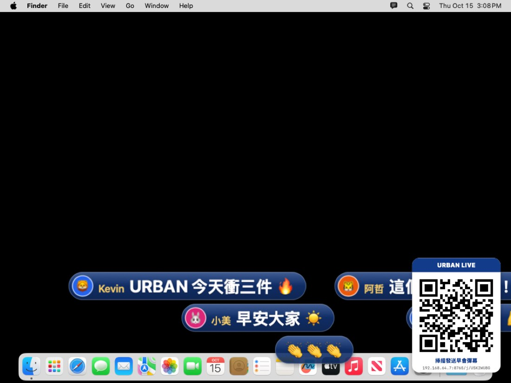
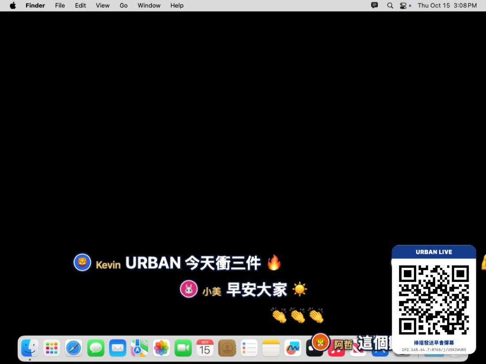
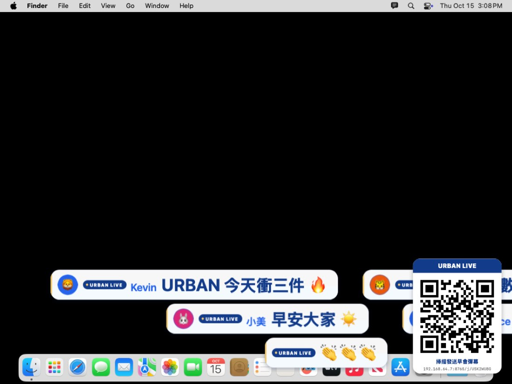
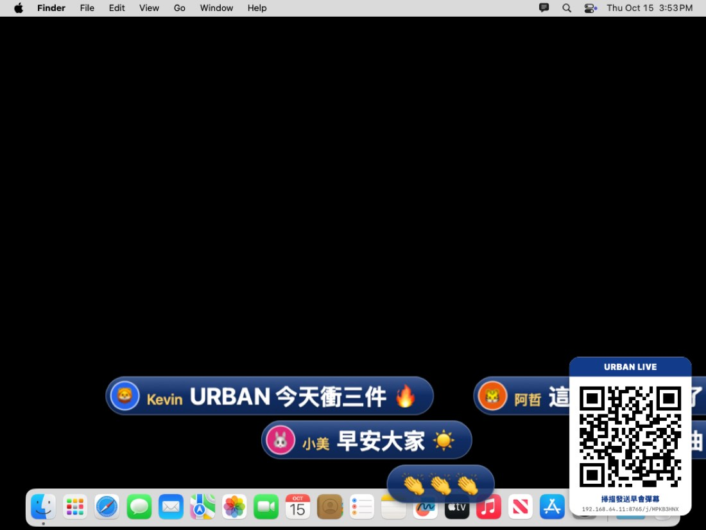
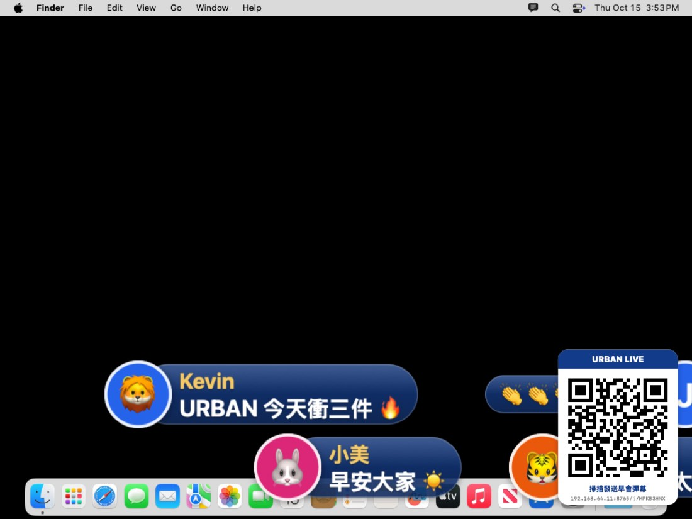
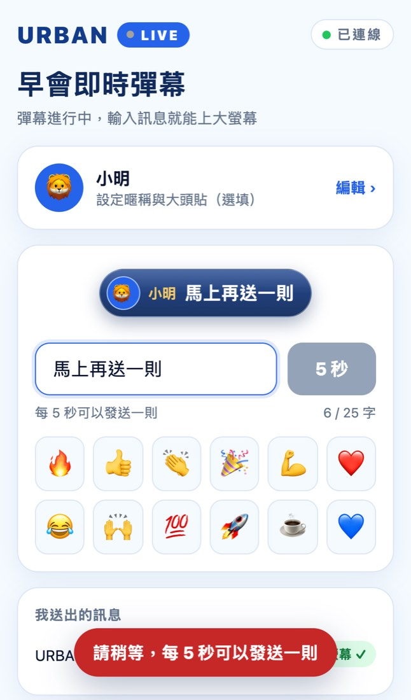
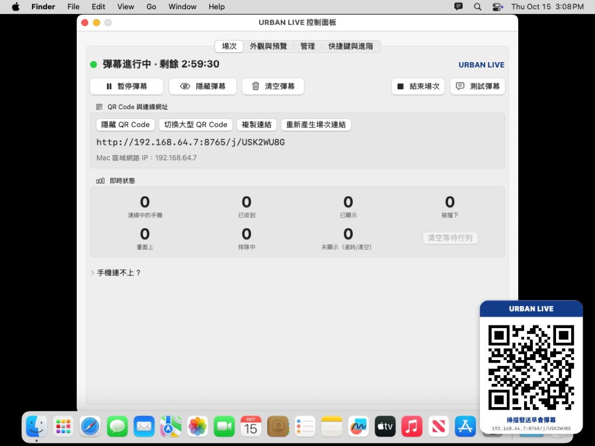
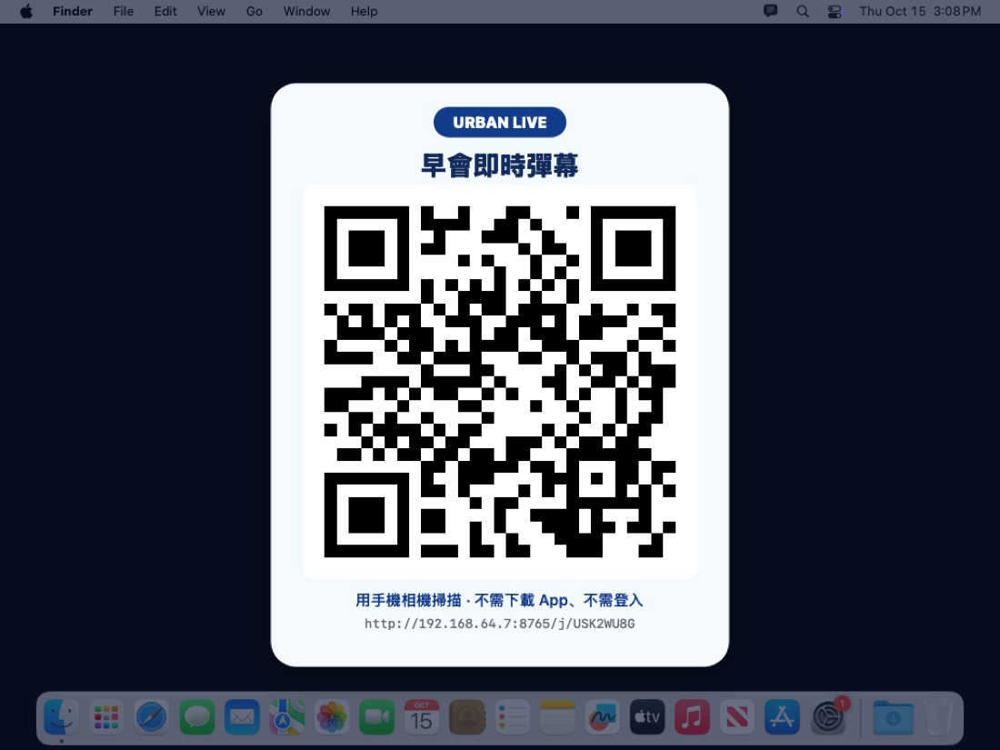

# URBAN LIVE｜Mac 即時彈幕系統

早會時，同仁用手機掃 QR Code，輸入文字或 Emoji，訊息就以漂亮的動畫從右向左飄過投影畫面。
**不改變原本的投影方式**：簡報照常在 Mac 播放，透過 AirPlay 鏡像到 Apple TV；彈幕是疊在畫面最上層的透明圖層，簡報不需要上傳到任何系統。

```
同仁手機 ──同一個 Wi-Fi──▶ Mac（URBAN LIVE）──AirPlay 鏡像──▶ Apple TV ──▶ 投影機 / 電視
```

> 📘 **第一次使用請看 [使用教學](docs/GUIDE.md)**：安裝、每天早會流程、同仁手機操作（可直接轉傳）、快捷鍵、問題排除。

| 玻璃膠囊（預設） | 經典高對比 | URBAN LIVE 訊息卡 |
| --- | --- | --- |
|  |  |  |

大頭貼與暱稱大小（控制面板可切換）：

| 標準（單行） | 大（預設） | 特大 |
| --- | --- | --- |
|  |  |  |

| 手機發送頁 | 控制面板 | 大型 QR Code（開場掃描用） |
| --- | --- | --- |
|  |  |  |

驗收畫面：手機上傳人像照片當大頭貼、送出「URBAN 今天衝三件 🔥」，出現在全螢幕視窗（紅色，模擬播放中的簡報）上方：


> 以上皆為 GitHub Actions macOS 機器上的實際截圖（1024×768 虛擬螢幕）。

## 功能

- **透明彈幕圖層**：無邊框、置頂、滑鼠穿透、不搶鍵盤焦點；支援多個桌面（Spaces）、全螢幕 App 與 AirPlay 鏡像。
  自動偵測簡報播放視窗的層級並墊高（詳見 [架構說明](docs/ARCHITECTURE.md)）。
- **三種樣式**：A 玻璃膠囊（預設）、B 經典高對比、C URBAN LIVE 訊息卡；URBAN 品牌色。
- **暱稱與大頭貼**：觀眾可設定暱稱（最多 10 字）與大頭貼（12 種動物 Emoji 或上傳照片）。預設「大」：暱稱在訊息上方、大頭貼放大，照片人像在投影上認得出是誰；可切換「標準（單行）」或「特大」（大頭貼超出膠囊）。照片以 320 px 上傳，直式照片自動往上裁避免切到頭。主持人可關閉暱稱、大頭貼或照片大頭貼。實測 200 人各自上傳不同照片：全部顯示正確，App 記憶體最高約 80 MB（活動監視器約 40 MB）。
- **可讀性**：以 1920×1080 為基準，預設 48 px（可調 32～72），自動依螢幕解析度換算；蘋方 / SF 粗體、彩色 Emoji；控制面板有深色 / 白色 / 照片背景的即時預覽。
- **動畫**：右進左出、約 10 秒（可調 6～16）、軌道分配不重疊不追撞、同時最多 5 則（可調），其餘排隊。
- **顯示區域**：全螢幕 / 上方 30% / 下方 30%（預設下方），即時切換。
- **QR Code**：開始場次自動產生；角落小 QR 或大型 QR；複製連結；重新產生場次連結（舊 QR 立即失效）。
- **防洗版**：每人每 5 秒 1 則、25 字上限、敏感詞、重複訊息、佇列上限、封鎖特定觀眾、場次有效時間。
- **即時回報**：手機會顯示「已送出 → 已上大螢幕 ✓」，未送達就顯示失敗，**不假裝成功**。
- **講師超棒投票**：主持人輸入講師姓名，同仁手機出現「👏 講師超棒！」按鈕（每人每位講師一票），大螢幕角落即時顯示票數並飄出 👏。
- **數據統計**：參與人數、最高同時在線、發言人數、彈幕數、講師票數、換名次數（和「換名王」XD）；**本月最佳講師**排行（依總票數或得票率），可在大螢幕公布、匯出 CSV。統計只存在這台 Mac。

## 安裝

### 下載
1. 到 GitHub 專案的 **Actions** →「macOS build & tests」→ 最新一次成功（綠色勾勾）的執行 → 下方 Artifacts 下載 **URBAN-LIVE-macOS**。
2. 解壓縮後打開 `URBAN-LIVE.dmg`，把 **URBAN LIVE** 拖到「應用程式」。

（也可以自己編譯：安裝 Xcode 或 Command Line Tools 後執行 `./scripts/build-app.sh`，產出在 `dist/`。）

### 第一次打開（測試版必讀）
這是**測試版**：App 使用 ad-hoc 簽章，**沒有經過 Apple 公證**（公證需要 Apple Developer Program 付費帳號與 Developer ID 憑證，目前沒有），所以 macOS 會擋下第一次開啟：

1. 在「應用程式」雙擊 URBAN LIVE → 出現「無法打開」→ 按「完成」。
2. 打開 **系統設定 → 隱私權與安全性**，往下捲到「安全性」，按 **「強制打開」**（macOS 14 以前可在 Finder 對 App 按右鍵 →「打開」）。
3. 之後就能正常開啟。

會出現的系統詢問：
- **「是否允許接受連入的網路連線？」** → 允許（手機要連進來）。
- **「是否允許尋找區域網路上的裝置？」**（較新的 macOS）→ 允許。

不需要「輔助使用」或「螢幕錄製」權限。

## 每天早會的使用流程

（完整圖文步驟見 [使用教學](docs/GUIDE.md#二每天早會約-2-分鐘)）

1. Mac 與同仁手機連**同一個 Wi-Fi**。
2. 控制中心 →「螢幕鏡像」→ 選 Apple TV →「**鏡像**內建顯示器」（不要選延伸顯示器）。
3. 打開 **URBAN LIVE**（選單列出現對話框圖示，並打開控制面板）。
4. 按 **「開始彈幕」** → 投影右下角出現 QR Code。開場可按「切換大型 QR Code」讓大家掃。
5. 同仁用手機相機掃 QR Code → 輸入訊息 → 發送。
6. 照常播放簡報；彈幕在上方飄過，滑鼠與鍵盤照常操作簡報。
7. 早會結束按 **「結束場次」**（手機會顯示「場次已結束」）。

**第一次在 Keynote 使用前，請先做一次「相容性測試」**（控制面板 → 快捷鍵與進階），步驟見 [docs/TESTING.md](docs/TESTING.md#4-實機驗收步驟約-10-分鐘會前做一次)。

## 操作

| 功能 | 控制面板 / 選單列 | 預設全域快捷鍵（簡報播放中也有效） |
| --- | --- | --- |
| 顯示 / 隱藏彈幕 | ✅ | **⇧⌘B** |
| 暫停 / 恢復 | ✅ | **⇧⌘P** |
| 顯示 / 隱藏 QR Code | ✅ | **⇧⌘Q** |
| 清空彈幕 | ✅ | ⌃⌥⌘C |
| 開始彈幕、結束場次、大型 QR、複製連結、重新產生連結、測試彈幕 | ✅ | |
| 清空等待佇列、封鎖觀眾、外觀與防洗版設定 | 控制面板 | |
| 講師超棒投票、本場數據、本月最佳講師、匯出 CSV | 控制面板（「場次」「投票與統計」） | |

- 快捷鍵可在「控制面板 → 快捷鍵與進階」重新錄製。註冊失敗（被其他 App 佔用）會顯示警告。
- **⇧⌘Q 也是 macOS「登出」的快捷鍵**：URBAN LIVE 執行時通常會優先攔截；若你按下後出現登出對話框，請改成其他組合。
- Keynote 全螢幕播放時選單列不會出現，請用快捷鍵。
- 關閉控制面板後彈幕服務繼續在背景執行；從選單列圖示或再次打開 App 可回到控制面板。
- **暫停**：畫面上的彈幕跑完，新訊息被擋下，手機顯示「主持人暫停了彈幕」。**隱藏**：整個彈幕圖層（含 QR Code）暫時隱藏。

## 網路

預設使用**同一個 Wi-Fi**，不需要任何雲端服務或費用。訪客 Wi-Fi 隔離、手機用行動網路等情況的替代方案（iPhone 熱點、獨立路由器、Cloudflare Tunnel）見 [docs/NETWORK.md](docs/NETWORK.md)。

## 常見問題

**手機打不開網頁 / 一直轉圈**
- 手機與 Mac 必須在同一個 Wi-Fi；手機用 4G/5G 連不到。
- 公司「訪客 Wi-Fi」通常開啟用戶端隔離 → 改用內部 Wi-Fi（或見 [NETWORK.md](docs/NETWORK.md)）。
- 系統設定 → 網路 → 防火牆：確認 URBAN LIVE 允許連入連線。
- Mac 開著 VPN，或同時有 Wi-Fi 與有線網路 → 控制面板「網路介面」選 Wi-Fi（通常是 en0）。

**手機顯示「這個連結已失效」**：主持人按了「重新產生場次連結」或場次已結束 → 重新掃描大螢幕上的 QR Code。

**手機顯示「目前彈幕太多，請稍後再送」**：同時最多 5 則、排隊最多 12 則；人多時可在控制面板調高「同時最多顯示」或改用全螢幕區域。

**Keynote 播放時看不到彈幕**：依序試 [Keynote 可行方案](docs/TESTING.md#5-keynote-可行方案依序嘗試) B → C → D，並把 `~/Library/Logs/URBANLive/` 的相容性測試紀錄傳給開發者。

**Apple TV 上看不到、Mac 上看得到**：確認是「鏡像」而不是「延伸顯示器」（相容性測試視窗會顯示「啟用中 1 個」）。

**App 意外關閉**：重新打開即可。進行中的場次會沿用同一個連結，手機會自動重新連線（不用重掃）。

**埠號 8765 被佔用**：App 自動改用 8766、8767…，QR Code 會跟著更新。

**100 個人都上傳自己的照片當大頭貼，會不會變慢？**
不會。實測 200 支手機各自上傳不同的照片：全部連線 0.2 秒內完成、每則彈幕都顯示發送者自己的照片，
App 記憶體從 15 MB 增加到約 40 MB（活動監視器的數字），CPU 平均約 1%（[測試結果](docs/TESTING.md#26-100200-人都上傳自己的照片)）。
- 照片在手機上就先裁成 320 px 並壓縮（通常 10～50 KB），Mac 只保存這個壓縮檔，輪到他的彈幕上螢幕時才解碼。
- 畫面上仍然同時最多 5 則（可調），不會因為照片多而塞滿；照片只影響「誰的頭像」，不影響彈幕數量。
- 照片只存在 Mac 的記憶體裡，不寫入磁碟、不上傳雲端；手機離線或場次結束就刪除。
- 不想顯示照片時，控制面板關閉「允許照片大頭貼」，已經連線的人也會立即改用暱稱首字；有人用不當照片時，可在「管理」依暱稱封鎖他（立即斷線）。

## 測試結果摘要

詳見 [docs/TESTING.md](docs/TESTING.md)（已驗證 / 尚未驗證分開列出）。

- ✅ 自動化驗證（macOS 15 實機 CI）：單元測試（71 項）、協定測試、QR Code 截圖解碼、彈幕覆蓋四種全螢幕方式、Chrome 手機端對端（上傳人像照片、發送到上螢幕約 0.2～0.6 秒、按「講師超棒」）、200 支手機壓力測試且每支各自上傳不同照片大頭貼並同時投票（全數連線、200 票 15 ms 內全部回覆、回條 p95 < 70 ms、App 記憶體最高 80 MB／活動監視器約 40 MB、CPU 平均約 3%）、統計檔內容（人數、票數、換名次數、沒有 IP）。
- ⚠️ 需要你實機確認：Keynote / PowerPoint 全螢幕播放、AirPlay → Apple TV → 投影機、投影上的 QR Code 掃描、真實 Wi-Fi 與手機、快捷鍵、長時間穩定性。

## 已知限制

- 測試版：未經 Apple 公證，第一次開啟需手動允許；不是正式發行版本。
- 手機必須連得到 Mac（預設同一個 Wi-Fi）。
- 彈幕只顯示在主螢幕（鏡像模式下就是唯一的螢幕）。
- 預設同時 5 則，螢幕每分鐘最多約 30 則；200 人同時狂送時多數人會收到「稍後再送」。
- 沒有雲端：訊息內容與照片只在現場顯示，不會儲存；統計只保存數字與講師姓名，存在這台 Mac。
- 講師投票以網路位址區分「一個人」：同一支手機換瀏覽器也不能重投；但同一個人用兩支手機可以投兩票，經過共用出口 IP 的網路（例如部分通道設定）會被當成同一人。

## 開發

```bash
swift test                         # 核心邏輯單元測試
./scripts/build-app.sh             # 打包 App、ZIP、DMG（UNIVERSAL=1 同時支援 Apple 晶片與 Intel）
./scripts/smoke-test.sh            # 整合測試（需先 cd tests && npm ci）
open "dist/URBAN LIVE.app" --args --start-session --demo   # 展示模式
```

- 使用教學：[docs/GUIDE.md](docs/GUIDE.md)
- 架構與技術選型（Swift/AppKit vs Tauri）：[docs/ARCHITECTURE.md](docs/ARCHITECTURE.md)
- 網路方案：[docs/NETWORK.md](docs/NETWORK.md)
- 測試與實機驗證：[docs/TESTING.md](docs/TESTING.md)
- 品牌色：`Sources/URBANLive/Theme.swift`；三種樣式：`Sources/URBANLive/DanmakuRenderer.swift`
