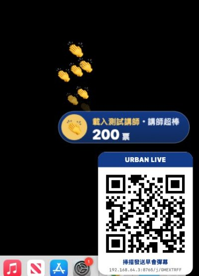
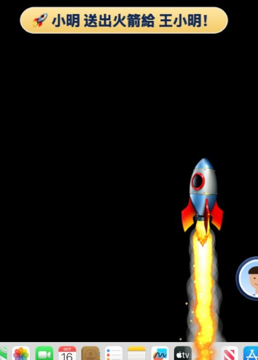
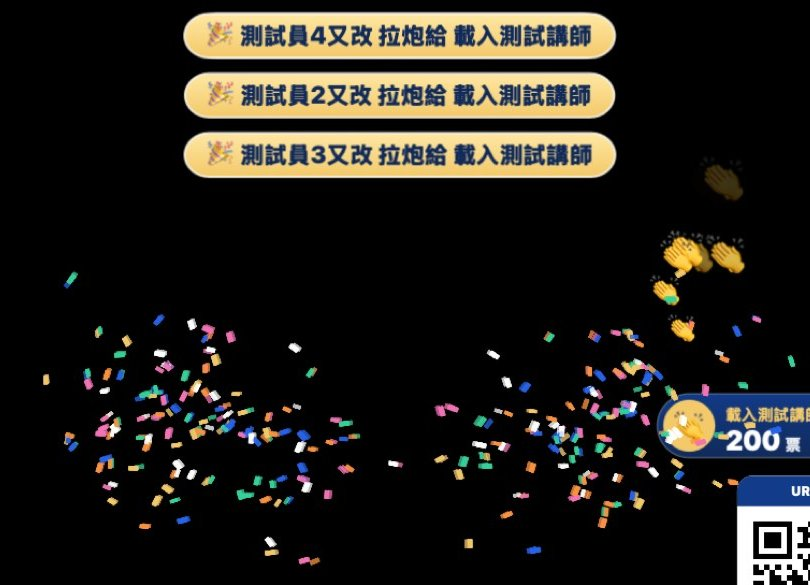
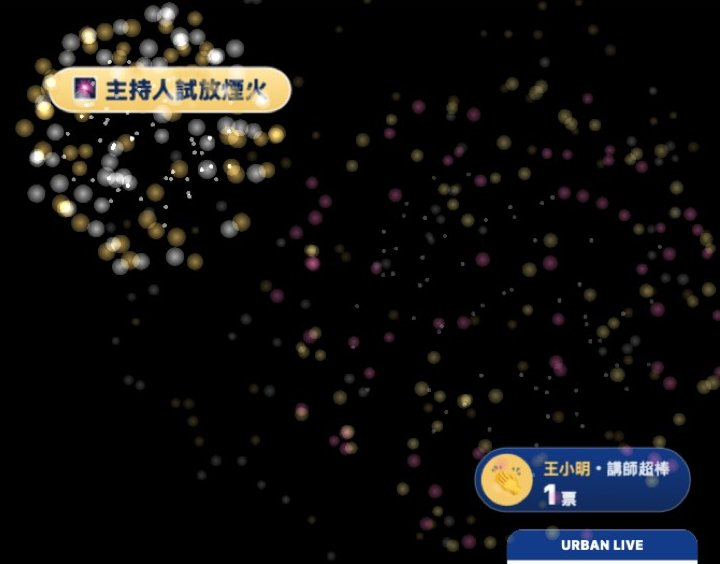
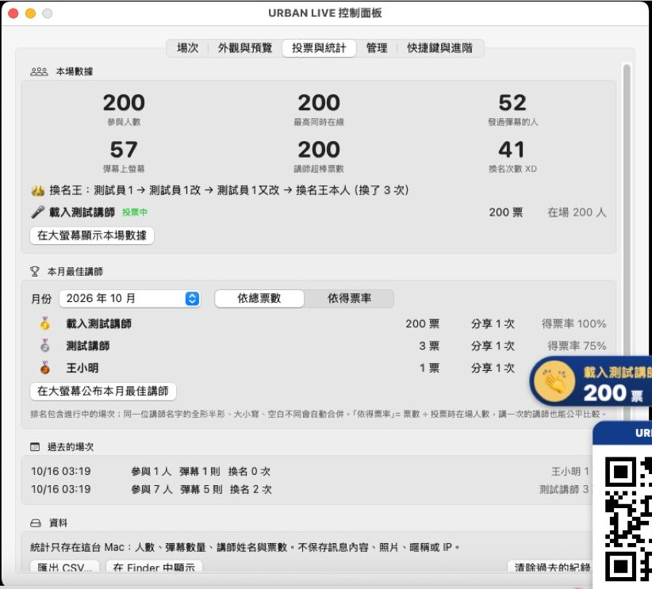
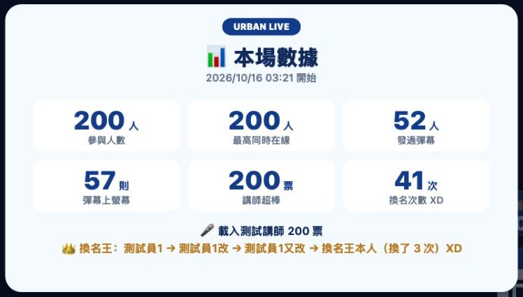
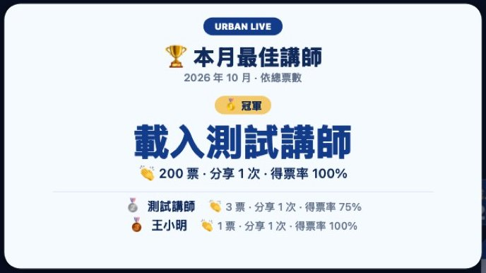

# URBAN LIVE 使用教學

給**主持人**（操作 Mac 的人）與**參加早會的同仁**看的操作說明。
第一次使用請從「一、第一次準備」開始；之後每天只要看「二、每天早會」。

- [一、第一次準備（約 15 分鐘，只做一次）](#一第一次準備約-15-分鐘只做一次)
- [二、每天早會（約 2 分鐘）](#二每天早會約-2-分鐘)
- [三、同仁手機怎麼用（可直接轉傳）](#三同仁手機怎麼用可直接轉傳)
- [四、會議中的操作與快捷鍵](#四會議中的操作與快捷鍵)
- [五、講師超棒投票與數據統計](#五講師超棒投票與數據統計)（含送禮特效）
- [六、調整彈幕外觀](#六調整彈幕外觀)
- [七、管理與防洗版](#七管理與防洗版)
- [八、遇到問題怎麼辦](#八遇到問題怎麼辦)

---

## 一、第一次準備（約 15 分鐘，只做一次）

### 1. 下載

1. 用瀏覽器打開 <https://github.com/urban669901-keynote/-/actions>（需要登入 GitHub 帳號才能下載）。
2. 點左側「**macOS build & tests**」→ 點最上面一筆**綠色勾勾**的執行紀錄。
3. 捲到頁面最下方「Artifacts」→ 點 **URBAN-LIVE-macOS** 下載（一個 zip 檔）。
4. 在「下載項目」雙擊 zip 解壓縮，會得到 `URBAN-LIVE.dmg`。

> Artifacts 預設保留 90 天；過期了就再找一次最新的綠色執行紀錄。

### 2. 安裝

1. 雙擊 `URBAN-LIVE.dmg`。
2. 把 **URBAN LIVE** 圖示拖到旁邊的「**應用程式**」資料夾。
3. 退出 DMG（Finder 側邊欄按 ⏏）。

> 一定要先拖進「應用程式」再打開，不要直接從 DMG 或「下載項目」裡執行。

### 3. 第一次打開（測試版必讀）

這是**測試版**，沒有經過 Apple 公證（公證需要付費的 Apple 開發者帳號），所以 macOS 第一次會擋下來。這是正常的，照下面做就好：

1. 到「應用程式」雙擊 **URBAN LIVE** → 出現「無法打開」的提示 → 按「**完成**」（不要按「丟到垃圾桶」）。
2. 打開「**系統設定**」→「**隱私權與安全性**」→ 往下捲到「安全性」→ 看到「已阻擋 URBAN LIVE…」→ 按「**強制打開**」→ 輸入 Mac 密碼。
3. 再按一次「**打開**」。之後就可以像一般 App 一樣直接打開。

> macOS 14 以前的版本也可以在 Finder 對 App 按右鍵 →「打開」。
> 不需要關閉 Gatekeeper 或任何系統安全設定，也不需要「輔助使用」或「螢幕錄製」權限。

打開後可能會跳出系統詢問，請按「**允許**」（手機要連進來）：
- 「要讓 URBAN LIVE 接受連入的網路連線嗎？」（有開防火牆時才會出現）
- 「URBAN LIVE 想要尋找並連接區域網路上的裝置」（較新的 macOS）

### 4. 認識畫面

打開後會出現兩個地方：

- **控制面板**：所有操作都在這裡。關掉面板後彈幕服務**繼續在背景執行**。
- **選單列圖示**（螢幕右上角的對話框圖示 💬）：點它可以開始 / 暫停 / 清空 / 結束，或「開啟控制面板…」。

控制面板有 5 個分頁：

| 分頁 | 用途 |
| --- | --- |
| 場次 | 開始彈幕、暫停、隱藏、清空、結束場次；QR Code 與網址；講師超棒投票；即時狀態（幾支手機連線、已顯示幾則） |
| 外觀與預覽 | 樣式、字體大小、速度、透明度、顯示區域、大頭貼大小；有即時預覽 |
| 投票與統計 | 本場數據（參與人數、換名次數…）、本月最佳講師排行、在大螢幕公布、匯出 CSV |
| 管理 | 封鎖不當發言的人、防洗版設定、敏感詞 |
| 快捷鍵與進階 | 修改快捷鍵、視窗層級、相容性測試 |

### 5. 會前彩排：Keynote 相容性測試（第一次一定要做）

彈幕要蓋在 Keynote 全螢幕簡報**上面**。我們已經用 4 種全螢幕方式自動測試過，但還沒在你的 Mac + Keynote + Apple TV 上實測，所以第一次請花 5 分鐘確認：

1. 先照「二、每天早會」的第 1～4 步，把 Mac 鏡像到 Apple TV、按「開始彈幕」。
2. 控制面板 →「快捷鍵與進階」→「**開啟相容性測試…**」→ 按「**開始 60 秒測試**」。
3. **60 秒內**切到 Keynote，按「播放」。
4. 看 Mac 螢幕和投影：有沒有「🧪 相容性測試 #1：看得到就代表 OK」的彈幕飄過？
5. 順便點滑鼠 / 按方向鍵翻頁，確認簡報操作正常（彈幕不會擋住滑鼠）。
6. 播放中按 **⇧⌘P**、**⇧⌘B**、**⇧⌘Q**，確認有反應，而且**不會跳出「登出」對話框**。
7. 按 Esc 結束播放 → 回到相容性測試視窗看「測試結果」。

**看不到彈幕？** 依序試：

| 方案 | 做法 |
| --- | --- |
| B | 「快捷鍵與進階」→「視窗層級」改成「**最高層級**」，再測一次 |
| C | Keynote 設定 → 幻燈片秀，若有「允許其他 App 使用螢幕」之類的選項就勾選（各版本名稱不同） |
| D（一定可行） | Keynote 選單「**播放 > 在視窗中播放**」，再按住 Option 點綠色按鈕把視窗放到最大；並在「系統設定 → 桌面與 Dock」設定自動隱藏 Dock 與選單列 |

PowerPoint 也一樣測一次；PowerPoint 的保底做法是「投影片放映 > 設定放映方式 >『觀眾自行瀏覽（視窗）』」。
都不行時，請把「打開紀錄資料夾」裡的檔案傳給開發者。

---

## 二、每天早會（約 2 分鐘）

1. **Wi-Fi**：Mac 連公司**內部 Wi-Fi**（請同仁連同一個；訪客 Wi-Fi 常常互相連不到）。
2. **鏡像到投影**：控制中心 →「螢幕鏡像」→ 選 Apple TV。確認是「**鏡像**內建顯示器」，**不要**選「作為獨立顯示器」（延伸桌面時彈幕不會出現在投影上）。
3. **打開 URBAN LIVE**：從「應用程式」或 Launchpad 打開，控制面板會出現。
4. **按「開始彈幕」**：投影右下角出現 QR Code，控制面板顯示「彈幕進行中 · 剩餘 2:59:59」。
5. **開場讓大家掃碼**：按「**切換大型 QR Code**」→ 畫面中央出現大 QR Code → 請大家用手機相機掃描 → 掃完按「**縮回角落**」。

   

6. **（建議）確認一下**：按「**測試彈幕**」，看投影上有沒有彈幕飄過。
7. **開始簡報**：打開 Keynote 照常播放。彈幕從右往左飄過畫面下方，滑鼠和鍵盤照常操作簡報。

   

8. **講師上台時**：「場次」分頁 →「講師超棒投票」輸入講師姓名 →「**開始投票**」。同仁手機會出現「👏 講師超棒！」按鈕，大螢幕角落顯示票數（見第五節）。換下一位講師時直接輸入新名字 →「換這位講師」。
9. **會議中**：用快捷鍵暫停、隱藏或清空（見第四節）。Keynote 全螢幕時看不到選單列，請用快捷鍵。
10. **（可選）收尾**：「投票與統計」分頁 →「在大螢幕顯示本場數據」或「在大螢幕公布本月最佳講師」，看完按「收起大螢幕上的卡片」。
11. **結束**：控制面板（或選單列圖示）按「**結束場次**」。同仁手機會顯示「場次已結束」，今天的 QR Code 就失效了，本場數據會存起來。

> - 每次「開始彈幕」都會產生**新的**連結與 QR Code，昨天的 QR Code 不能用。
> - 場次預設 3 小時後自動結束（「管理」可改 1～12 小時）。
> - 「結束場次」只結束今天的彈幕；要完全關閉 App 請點選單列圖示 →「結束 URBAN LIVE」。
> - App 不小心被關掉：重新打開即可，進行中的場次會沿用同一個 QR Code，同仁手機會自動重新連線。

---

## 三、同仁手機怎麼用（可直接轉傳）

> **不用下載 App、不用登入。** iPhone、Android 都可以。

1. 手機連**公司 Wi-Fi**（和現場電腦同一個；用 4G/5G 連不到）。
2. 打開**相機**，對準大螢幕右下角的 QR Code，點跳出來的連結。
3. （選填）點「**編輯 ›**」設定暱稱和大頭貼 → 按「**儲存**」：
   - 暱稱最多 10 個字，可以留空（大螢幕上就只顯示訊息）。
   - 大頭貼可以選動物 Emoji，或按「**📷 上傳照片**」用自己的照片（建議臉部清楚的照片；照片只傳到現場的電腦顯示，不會上傳到其他地方）。
4. 輸入文字，或點下面的 Emoji → 按「**發送**」。
5. 看下方「我送出的訊息」：**「已送出」→「已上大螢幕 ✓」** 就代表大家看到了。
6. 講師上台時，上方會出現「🎤 現在的講師」卡片：覺得講得好就按「**👏 講師超棒！**」。每位講師每個人可以投一次，按了會顯示「✓ 已投給 …」。
7. 「🎁 送禮特效」：按 🎉 拉炮、🎆 煙火或 🚀 火箭，大螢幕就會播放特效並顯示是誰送的（講師投票中時算送給講師）。**完全免費**，每場有次數限制（預設拉炮 5、煙火 2、火箭 1），按鈕上會顯示「剩幾次」。

| 手機上看到 | 意思 |
| --- | --- |
| 請稍等，每 5 秒可以發送一則 | 發太快了，按鈕上會倒數秒數 |
| 目前彈幕太多，請稍後再送 | 大螢幕排隊滿了，過幾秒再送 |
| 主持人暫停中 | 主持人暫停了彈幕，恢復後就能再送 |
| 送出失敗 / 連不到電腦 | 確認手機連的是公司 Wi-Fi，再送一次 |
| 這個連結已失效 | 主持人換了新的 QR Code，請重新掃描大螢幕 |

小規則：每則最多 25 個字（Emoji 算 1 個字）、每 5 秒 1 則、同樣的內容 30 秒內不能重複送、不當字詞會被擋下。
換暱稱沒有限制，但主持人看得到「換名次數」和「換名王」XD

---

## 四、會議中的操作與快捷鍵

| 功能 | 快捷鍵（簡報全螢幕播放中也有效） | 說明 |
| --- | --- | --- |
| 暫停 / 恢復 | **⇧⌘P** | 畫面上的彈幕跑完，新訊息先擋下，手機顯示「主持人暫停中」 |
| 顯示 / 隱藏彈幕 | **⇧⌘B** | 整個彈幕圖層（含 QR Code）暫時藏起來，例如要播影片或看重要數字時 |
| 顯示 / 隱藏 QR Code | **⇧⌘Q** | 只收起角落的 QR Code，彈幕照常 |
| 清空彈幕 | **⌃⌥⌘C** | 立刻清掉畫面上正在飄的彈幕 |

- 快捷鍵可以在「快捷鍵與進階」按「錄製」改成別的組合。
- **⇧⌘Q 也是 macOS「登出」的快捷鍵**。URBAN LIVE 開著時通常會先接到；如果按了出現登出對話框，請按「取消」，並把它改成其他組合。
- 控制面板「場次」分頁的「即時狀態」可以看到連線中的手機數、已顯示幾則、排隊中幾則。

---

## 五、講師超棒投票與數據統計

### 講師超棒投票

1. 「場次」分頁 →「講師超棒投票」→ 輸入講師姓名（或從「最近的講師」選）→「**開始投票**」。
2. 同仁手機上出現「🎤 現在的講師」與「👏 講師超棒！」按鈕；每個人對每位講師只能投一次（以手機的網路位址區分，重新整理網頁也不能重投）。
3. 大螢幕的 QR Code 上方出現票數膠囊；每有人投票就跳一下、飄出 👏。不想顯示時關閉「大螢幕顯示票數」。
4. 換講師：直接輸入下一位的名字 →「**換這位講師**」（上一位自動結束）。全部講完按「結束投票」。

### 送禮特效（免費）

- 同仁手機上有「🎁 送禮」三個按鈕：**🎉 拉炮**（兩側噴出彩帶）、**🎆 煙火**（空中綻放三朵煙火）、**🚀 火箭**（從下方噴射衝上天，最後炸出金色火花），
  大螢幕上方同時出現「🚀 小明 送出火箭給 王小明！」字幕。
- **不涉及金錢**：沒有儲值、沒有付款，只是好玩的特效。
- 「場次」分頁 →「送禮特效（免費）」：
  - 開關「開放同仁送禮」。
  - 每種禮物「每人每場」可以送幾次（0 = 不開放；預設拉炮 5、煙火 2、火箭 1）。調整後手機上的剩餘次數會立即更新。
  - 「試放」：先在大螢幕看看效果（不計入統計）。
- 防洗版：同一個人每 3 秒最多送 1 次；火箭一次只飛一支，其他特效最多同時 4 個，排隊超過 30 個時手機會收到「大螢幕特效太多了，請稍後再送」（不會扣次數）。
- 想立刻停掉所有特效：按「清空彈幕」或 ⌃⌥⌘C。
- 送了多少禮物會出現在「本場數據」、講師時段與「本月最佳講師」（排名仍然依票數或得票率，禮物只是顯示）。

| 🚀 火箭 | 🎉 拉炮（很多人同時送） | 🎆 煙火 |
| --- | --- | --- |
|  |  |  |

### 數據統計（「投票與統計」分頁）

| 項目 | 說明 |
| --- | --- |
| 參與人數 | 本場有連上的人數（同一支手機重新連線只算一次） |
| 最高同時在線 | 同一時間最多幾個人連著 |
| 發過彈幕的人 / 彈幕上螢幕 | 有幾個人發過彈幕、上了大螢幕幾則（主持人的測試彈幕不算） |
| 講師超棒票數 | 本場所有講師的票數合計；下方列出每位講師的票數與在場人數 |
| 換名次數 XD | 有人把暱稱換成另一個名字就算一次（第一次設定、重新連線不算），並列出「👑 換名王」和他用過的名字 |
| 本場禮物 | 🚀 火箭、🎆 煙火、🎉 拉炮各送出幾個（主持人「試放」不算） |

按「**在大螢幕顯示本場數據**」可以把這些數字投到大螢幕上（會議結束前很適合）。

### 本月最佳講師

- 「投票與統計」分頁的「本月最佳講師」會列出這個月每位講師的總票數、分享次數與得票率，包含今天進行中的場次。
- 排名方式可選「**依總票數**」或「**依得票率**」（票數 ÷ 投票時在場人數，講一次的講師也能公平比較）。
- 同一位講師的名字有全形半形、大小寫、空白的差異會自動合併（例如「Amy Chen」和「amy chen」）；但「小明」和「王小明」會被當成不同的人，輸入時請統一用全名。
- 按「**在大螢幕公布本月最佳講師**」會出現冠軍與第 2～5 名的公布卡片；按「收起大螢幕上的卡片」或 ⌃⌥⌘C（清空）收起。

### 資料存在哪裡

- 統計只存在這台 Mac（`~/Library/Application Support/URBANLive/statistics.json`），不上傳雲端。
- 保存的只有：人數、彈幕數量、換名次數、講師姓名與票數。**不保存訊息內容、照片、暱稱或 IP**。
  進行中的場次會暫存由網路位址換算的代號（不直接存 IP），用來防止重複投票，場次結束後就刪除。
- 「匯出 CSV…」可以用 Excel / Numbers 打開（每位講師一列，含日期、票數、在場人數、得票率與該場的人數統計）。
- 「清除過去的紀錄…」會刪除已結束場次的數據與排行，無法復原（建議先匯出）。

---

## 六、調整彈幕外觀

控制面板 →「**外觀與預覽**」。上方的即時預覽可以切換「深色投影片 / 白色投影片 / 照片背景」，調整時直接看效果；按「發送測試彈幕」會真的出現在投影上。

| 設定 | 預設 | 建議 |
| --- | --- | --- |
| 樣式 | A 玻璃膠囊 | 投影片很花俏時改 C 訊息卡（白底最清楚）；想要傳統彈幕感用 B |
| 字體大小 | 48 px | 會議室很大、後排看不清楚 → 56～64 |
| 移動速度 | 通過約 10 秒 | 覺得太快看不完 → 12～14 秒 |
| 不透明度 | 100% | 想讓彈幕比較不搶簡報 → 80～90% |
| 顯示區域 | 下方區域 | 投影片底部有重要內容 → 上方區域；慶祝時刻 → 全螢幕 |
| 同時最多顯示 | 5 則 | 人多、想熱鬧一點 → 7～8 則（其餘自動排隊） |
| 大頭貼與暱稱大小 | 大 | 大家用照片、想認得出是誰 → 特大；想要彈幕矮一點 → 標準（單行） |
| 小型 QR 位置 / 大小 | 右下 / 220 px | 擋到投影片內容時換位置；後排掃不到 → 調大 |

| A 玻璃膠囊（預設） | B 經典高對比 | C URBAN LIVE 訊息卡 |
| --- | --- | --- |
|  |  |  |

字體大小以 1920×1080 為基準，Mac 解析度不同會自動換算；按「外觀恢復預設值」可以一鍵還原。

---

## 七、管理與防洗版

控制面板 →「**管理**」：

- **封鎖**：「最近發言的觀眾」列出每個人的暱稱與發言數 → 按「**封鎖**」，對方立即斷線、不能再送。按錯了到「已封鎖」按「解除封鎖」。
- **防洗版**：每人每幾秒 1 則（預設 5 秒）、單則字數（預設 25 字）、重複內容限制（預設 30 秒）、場次有效時間（預設 3 小時）。
- **敏感詞**：一行一個，含有這些字詞的訊息與暱稱會被擋下（會忽略空白、標點與全半形）。按「恢復預設詞庫」可還原。
- **照片大頭貼**：不想讓大家上傳照片時，到「外觀與預覽」關閉「允許觀眾上傳照片當大頭貼」，已連線的人也會立即改用暱稱首字。

其他處理方式：
- **QR Code 被拍下來外流**：「場次」分頁按「**重新產生場次連結**」，舊的 QR Code 立即失效，現場的人重新掃一次即可。
- **排隊太多、想從頭開始**：「場次」分頁按「清空等待佇列」，排隊中的訊息不會顯示，手機會收到通知。

> 安全性：手機網頁**只能**看網頁和送彈幕，沒有任何控制 Mac 的功能；所有主持人操作都只能在 Mac 上進行。訊息與照片不存檔、不上雲端。

---

## 八、遇到問題怎麼辦

| 狀況 | 怎麼做 |
| --- | --- |
| 手機掃了打不開、一直轉圈 | ① 手機和 Mac 連同一個 Wi-Fi（不能用 4G/5G）② 訪客 Wi-Fi 常開啟隔離 → 改用內部 Wi-Fi ③ 「系統設定 → 網路 → 防火牆」允許 URBAN LIVE ④ Mac 開著 VPN → 關掉，或在「場次」分頁的「網路介面」選 Wi-Fi（通常是 en0；Mac 同時有多個網路時才會出現這個選項）。控制面板「手機連不上？」也有提示 |
| 公司 Wi-Fi 一定連不到 | 見 [網路方案](NETWORK.md)：iPhone 個人熱點、獨立路由器等替代做法 |
| Mac 上看得到彈幕、投影上沒有 | 確認是「鏡像」不是「作為獨立顯示器」（相容性測試會顯示「鏡像：是 / 否」） |
| Keynote 播放時看不到彈幕 | 照第一節第 5 步的方案 B → C → D |
| 按 ⇧⌘Q 跳出登出對話框 | 按「取消」，到「快捷鍵與進階」把 QR Code 快捷鍵改成其他組合 |
| 快捷鍵沒反應 | 「快捷鍵與進階」若顯示「已被其他 App 使用」，請換一組 |
| 手機顯示「這個連結已失效」 | 場次已結束或換了新連結 → 重新掃描大螢幕上的 QR Code |
| 手機顯示「目前彈幕太多」 | 正常保護機制。人多時可調高「同時最多顯示」或改用全螢幕區域 |
| App 被關掉了 | 重新打開，場次和 QR Code 會沿用，手機自動重連 |
| 打開時說「已損毀，無法打開」 | 先確認已照第一節第 3 步操作；若仍出現，重新下載一次。仍不行時可在「終端機」執行 `xattr -dr com.apple.quarantine "/Applications/URBAN LIVE.app"`（只移除這個 App 的「從網路下載」標記，不會關閉 Gatekeeper） |

需要回報問題時，請附上：控制面板「快捷鍵與進階」→「打開紀錄資料夾」裡的檔案（`~/Library/Logs/URBANLive/`）。

---

更多資訊：[README](../README.md)｜[測試結果與實機驗證清單](TESTING.md)｜[網路方案](NETWORK.md)｜[技術架構](ARCHITECTURE.md)
